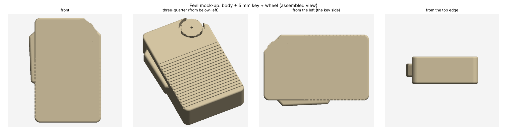
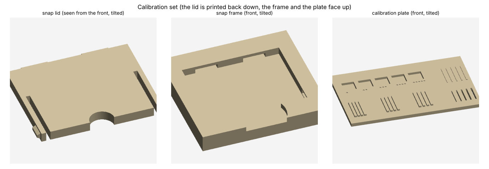
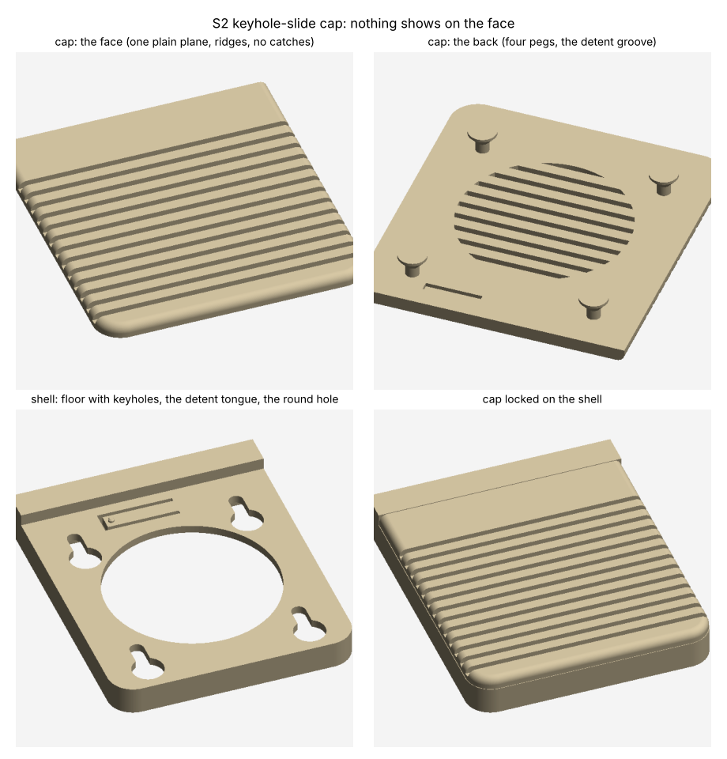
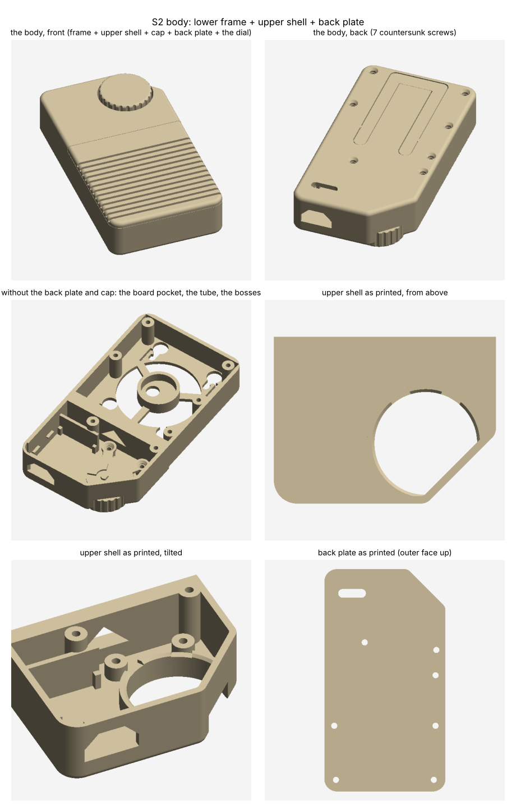
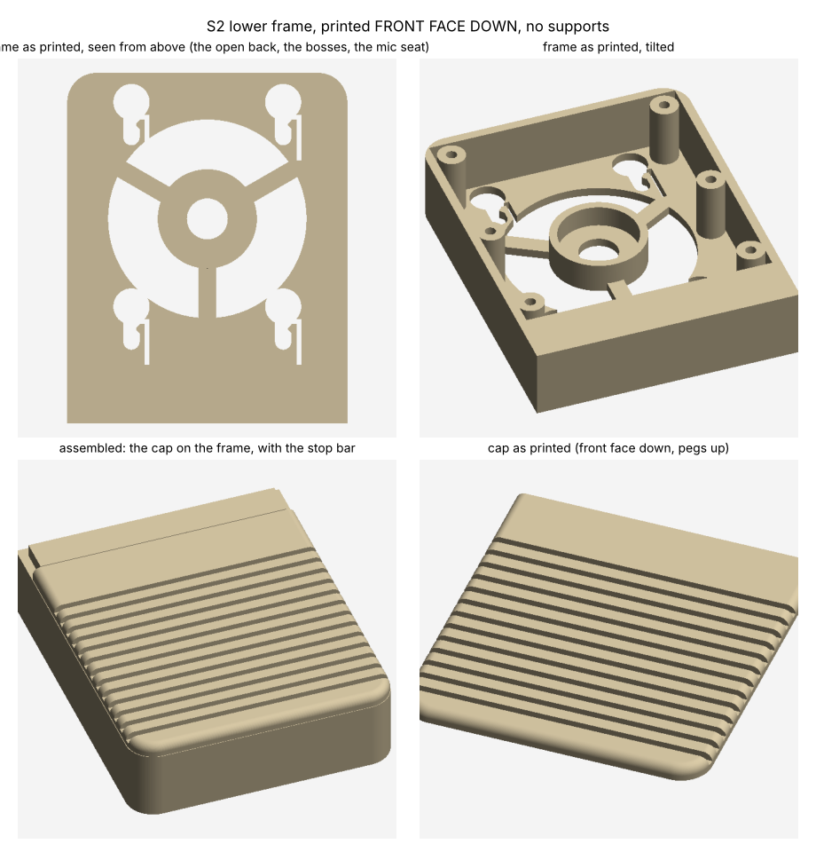

# cad/: parametric CAD for talk.01

Licence: [CERN-OHL-P-2.0](../LICENSES/CERN-OHL-P-2.0.txt) (see [`../LICENSING.md`](../LICENSING.md)). Status: **the first prints; every size is tentative until the real parts are measured** ([`../docs/parts-list.md`](../docs/parts-list.md)). The spec: [`../docs/spec-v0.1.md`](../docs/spec-v0.1.md).





## What is here

| File | What |
|---|---|
| [`params.py`](params.py) | all shared sizes (body 58 × 92 × 24, chamfer 15, key, wheel Ø19, ridges, hole) |
| [`mockup.py`](mockup.py) | the **feel mock-up**: body blank, three key blocks (3, 5, 7 mm), the wheel |
| [`calibration.py`](calibration.py) | the **calibration set**: a plate, five tabs, and a snap-fit lid and frame |
| [`check.py`](check.py) | numeric checks: watertight, size, fits the A1 mini, interferences, snap arm strain |
| [`preview.py`](preview.py) | the preview pictures above (a small z-buffer renderer) |
| [`out/`](out/) | the STL files (and a STEP of the body) ready to slice |

## S2 (the chosen body) and the cap

[`s2_params.py`](s2_params.py), [`s2_cap.py`](s2_cap.py) and [`check_s2_cap.py`](check_s2_cap.py): the **keyhole-slide cap** (one complete plane, nothing visible on the face) with the lower part of the S2 front shell as a test piece. Files: `out/s2_cap_shell.stl` (print as exported, front up, **supports from the bed under the detent tongue**) and `out/s2_cap_PRINT_face_down.stl` (already flipped for printing: front face down, pegs up). The mechanism: [`../docs/mechanical-plan-S2.md`](../docs/mechanical-plan-S2.md) §4 and [`../docs/print-test-guide/cap-keyhole.png`](../docs/print-test-guide/cap-keyhole.png).



### The dial

[`s2_dial.py`](s2_dial.py): the wheel (Ø21, 2 mm proud), its bearing plate and the cam with two ridges (Gray code through two switches). The switch carrier is not drawn yet. See [`../docs/mechanical-plan-S2.md`](../docs/mechanical-plan-S2.md) §11.

### The upper shell and the back plate

[`s2_upper.py`](s2_upper.py), [`s2_back.py`](s2_back.py), [`check_s2_upper.py`](check_s2_upper.py), [`assemble.py`](assemble.py): the control zone (printed front face down) and the flat back plate (outer face down, six countersunk M2 holes, two top hooks). [`s2_dial.py`](s2_dial.py): the wheel and its module. [`s2_key.py`](s2_key.py): the push-to-talk key (printed on its back). [`s2_stand.py`](s2_stand.py): the flap stand. [`s2_hatch.py`](s2_hatch.py): the debug hatch's lid. [`check_s2_back.py`](check_s2_back.py): fit and print checks of these. [`s2_graphics.py`](s2_graphics.py): the marks on every face, on one grid, in three styles (A, B, C: set `STYLE`); `*_ink.stl` are the same marks as inlays for a second colour. See [`../docs/mechanical-plan-S2.md`](../docs/mechanical-plan-S2.md) §11 and §13. Engraved lettering uses JetBrains Mono (SIL Open Font Licence) if it is installed, else CadQuery's default font.



### The lower frame, printed without supports

[`s2_frame.py`](s2_frame.py), [`check_s2_frame.py`](check_s2_frame.py), [`boss_test.py`](boss_test.py): the floor under the cap with its walls, six screw bosses, the microphone seat and the in-plane catches, printed **cap-seat face down**; plus a screw-boss coupon. The reasoning: [`../docs/mechanical-plan-S2.md`](../docs/mechanical-plan-S2.md) §10.



*Superseded:* [`s2_lower.py`](s2_lower.py) (a lid with visible snap arms in a frame) is kept for history only.

## Regenerating

```bash
python3 -m venv .venv && .venv/bin/pip install -r cad/requirements.txt
.venv/bin/python cad/mockup.py && .venv/bin/python cad/calibration.py
.venv/bin/python cad/check.py && .venv/bin/python cad/preview.py
```

## What to print first (Bambu Lab A1 mini, PLA)

Every file is already oriented for printing (Z up): import it and print it as it is. The body's rounded back edge on the bed may look slightly rough; it is a feel prototype. Suggested settings: 0.4 mm nozzle, 0.2 mm layers, 3 walls, 10 to 15 % infill for the body, no supports. The weight and time are shown by the slicer; I have not estimated them.

| File | Qty | Orientation | What it answers |
|---|---|---|---|
| `mockup_body.stl` | 1 | **front face up**, back on the bed | the size and shape in the hand; the wheel pocket; how the ridges feel under the fingers |
| `mockup_key_3mm.stl`, `_5mm`, `_7mm` | 1 each | **as exported** (the slanted profile on the bed; the stuck-on side stands upright, so the visible slanted face prints smooth) | which protrusion is comfortable |
| `mockup_wheel.stl` | 1 (a dark colour) | flat | the wheel's size and rim; use a piece of **1.75 mm filament** as the axle (a drop of glue on one end) |
| `calibration_plate.stl` | 1 | face up | clearances, ridge gaps, through-slots, line widths |
| `calibration_tabs.stl` | 1 | flat | the five tabs for the plate's pockets |
| `snap_frame.stl` | 1 | **front up** (the groove sits under a 0.8 mm overhang) | the snap-fit lid's recess, lip and grooves |
| `snap_lid.stl` | 1 | **back down** | the lid with two hooks and two in-plane arms |

Stick a key block to the body's left edge with **double-sided tape**, in the marked 0.4 mm recess.

**An illustrated how-to-test guide (Chinese):** [`../docs/print-test-guide/1-calibration.png`](../docs/print-test-guide/1-calibration.png) and [`../docs/print-test-guide/2-snap-and-feel.png`](../docs/print-test-guide/2-snap-and-feel.png).

## What to look for and report (photos help)

**Mock-up:** does the body feel too thick (24 mm) or too wide (58 mm) in the hand? For each key (3, 5, 7 mm): does it dig into the palm, can the thumb or the fingers reach it, how far does it need to stick out? Does the wheel's rim stick out enough to roll with a finger or thumb? Are the ridges comfortable? What does the weight feel like?

**Calibration plate and tabs:** the five pockets have a clearance of **0.15, 0.20, 0.25, 0.30 and 0.40 mm per side** (1 to 5 dots beside each pocket). Tell me **which tab drops in without rattling**. The three ridge groups have gaps of **0.8, 1.1 and 1.4 mm**: which are clean and open? The five through-slots are **0.6, 0.8, 1.0, 1.1 and 1.3 mm** wide: which are open? The five raised lines are **0.4, 0.6, 0.8, 1.0 and 1.2 mm** wide: which printed?

**Snap pair:** does the lid go in (hooks under the lip first, then press the bottom), does it click, is it too tight or too loose, does it come out with a nail in the scoop, and do the arms survive? **PLA is brittle: if an arm cracks, that is useful information, not a failure.** The same pair in PETG comes later.

## Checks run by `check.py` (2026-11-26)

All nine meshes are watertight and fit the A1 mini's 180 mm cube; the wheel in its pocket, the three key blocks on the body and the snap lid in its frame do not interfere (0 mm³); the wheel's rim sticks out of the chamfer by **1.23 mm**; the snap arm's strain at a 0.6 mm deflection is **about 0.55 %** by the beam formula (a hand calculation; well below the 1 % worked out earlier because the arm is longer and the interference smaller). These are checks by numbers, **not** a test of how it prints or feels.

## Conventions

X to the right, Y up, Z toward the front (z = 0 the back); the design sheets in `design/concepts` use y down from the top, converted by `Y()` in `params.py`.
