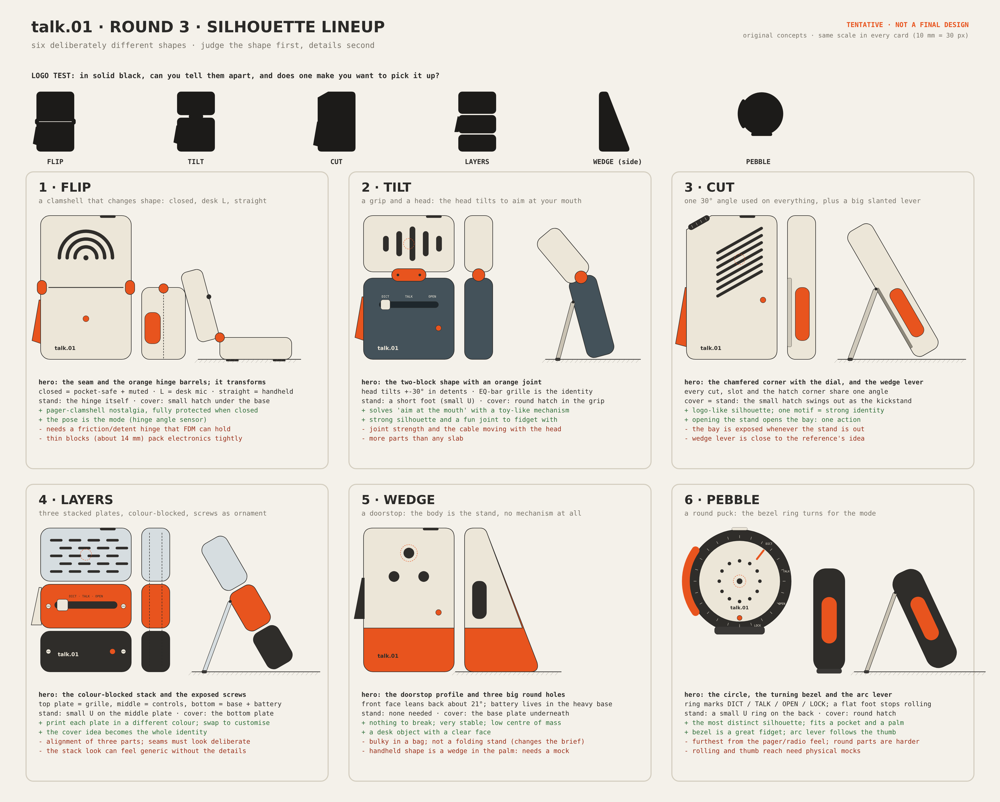

# Round 3 — silhouette lineup

Date: 2026-11-25 · Status: **sketches for the owner's taste. Details are minimal on purpose. Dimensions are guesses.**



Files: [`lineup.svg`](lineup.svg) · [`lineup.png`](lineup.png)

## Why this round looks different

The owner's verdict on round 2 was that it lacked something and did not catch the eye. The honest reading ([`../../design-principles.md`](../../design-principles.md)) is that round 2 was coherent but generic: rounded rectangles with annotations, no strong silhouette, very little detail. TE's method is many prototypes and one person with strong taste deciding. So this round is **six deliberately different shapes**, and the owner's job is only to react by feeling.

Start with the **logo test** strip at the top of the sheet: in solid black, which shapes can you tell apart, and which would you pick up?

## The six

| # | Name | Hero | Stand | Cover |
|---|---|---|---|---|
| 1 | **Flip** | a clamshell that changes shape: closed (pocket-safe, muted), desk L, straight (handheld) | the hinge itself | small hatch under the base |
| 2 | **Tilt** | two blocks with an orange joint; the head tilts to aim at your mouth | short foot (small U) | round hatch in the grip |
| 3 | **Cut** | one 30° angle on everything; chamfered corner with the dial; big wedge lever | **the hatch swings out as the stand** | the same hatch |
| 4 | **Layers** | three stacked colour-blocked plates, screws as ornament | small U on the middle plate | the bottom plate |
| 5 | **Wedge** | a doorstop: the body is the stand | none | base plate underneath |
| 6 | **Pebble** | a round puck; the bezel ring turns for the mode; arc lever | small U ring | round hatch |

The owner's new constraints are applied: **no full-back cover** (small hatches or a plate that is a real structural part), and **small U stands**, or **cover and stand combined** (Cut).

## How I would read it

- This is a taste test, not a ranking. I deliberately made the shapes far apart, so some will feel wrong; that is useful information.
- **Flip** and **Tilt** add a real mechanism that turns a boring slab into something to play with. Both depend on a hinge that FDM printing can hold; that is the risk.
- **Cut** is the most logo-like, with one motif. It is closest to the reference's slanted lever idea, so it needs the most care to stay original.
- **Layers** is the clearest way to make "swappable, printable plates" the identity.
- **Wedge** removes the stand mechanism entirely but changes the brief (no folding stand) and is bulky.
- **Pebble** is the most distinctive silhouette but furthest from pager and radio.
- Nothing is combined, on purpose.

## Questions

1. Gut check: which one or two attract you, and which do you dislike? One word each is plenty.
2. Is a shape that **transforms** (Flip, Tilt) exciting, or too fussy for a thing that lives in a bag?
3. Are Wedge and Pebble too far from the pager/radio feel, or exactly the kind of "bolder" you wanted?
4. Any real objects whose look you love? A name or a link is enough.

## What happens next

When one or two are picked, I develop them properly with the checklist: a repeated motif, a micro-label layer, exposed structure, a small joke, and a colour palette, drawn at the three distances. Then a printable mock of the hand-feel parts.

## Regenerating

[`../src/make_lineup.py`](../src/make_lineup.py), standard library only:

```bash
python3 design/concepts/src/make_lineup.py design/concepts/round-3
```
