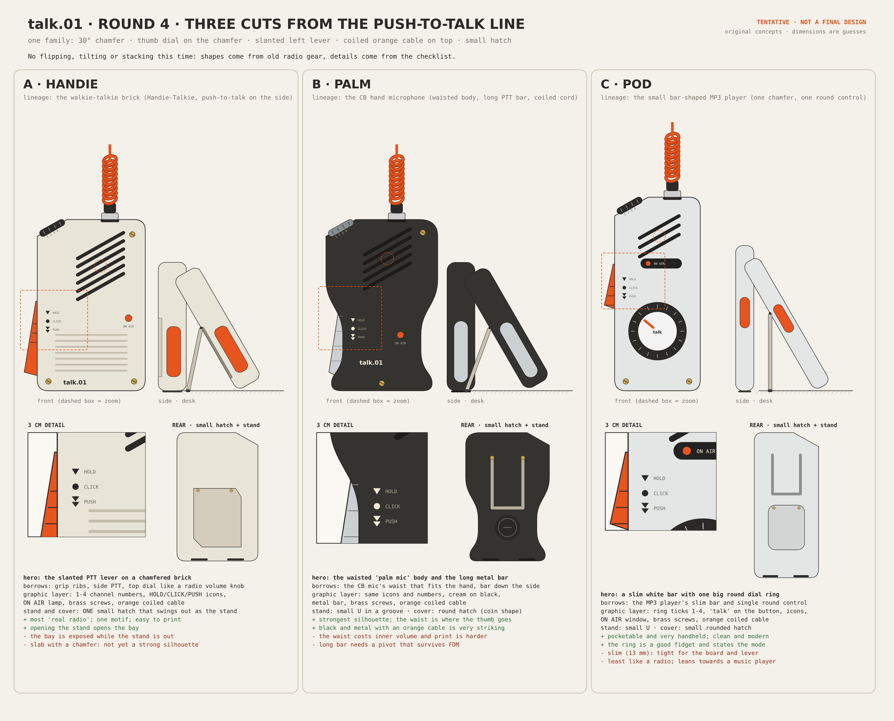

# Round 4 — three cuts from the push-to-talk line

Date: 2026-11-25 · Status: **sketches for discussion. Dimensions are guesses; nothing built or measured.**



Files: [`round4.svg`](round4.svg) · [`round4.png`](round4.png)

## What changed after round 3

The owner found round 3 "overdone" (flip, tilt, layers) but liked the **Cut** shape, and asked for a version that **starts from walkie-talkies, push-to-talk and telegraph gear**, keeps TE's flat graphic language, and treats the **coiled cable** as important. This round therefore:

- drops all moving-body ideas (no flip, tilt or stack);
- keeps one family of traits: a **30° chamfer** with a thumb dial on it, a **slanted lever on the left edge**, a **coiled orange cable** on the top edge, a **small hatch** (no full-back cover), and a **small U stand** or a **hatch that is the stand**;
- gives each sketch a **3 cm detail layer** (numbers 1-4 as "channels", HOLD / CLICK / PUSH pictograms, ribs, brass screws, an ON AIR lamp), following [`../../design-principles.md`](../../design-principles.md).

## The three

| | Lineage | Hero | Stand and cover |
|---|---|---|---|
| **A · Handie** | the walkie-talkie brick | the slanted lever on a chamfered brick, with grip ribs | one small hatch that swings out as the stand |
| **B · Palm** | the CB hand microphone | the waisted body and a long metal bar | small U in a groove; round coin hatch |
| **C · Pod** | the small MP3 player bar | a slim white bar with one big round dial ring | small U; small rounded hatch |

## Reading

- **Palm** has the strongest silhouette: the waist is where the thumb goes, and black plus metal with an orange cable is striking. It also costs inner volume and is harder to print.
- **Handie** is the most "real radio" and the easiest to print, but a chamfered slab is not yet a strong silhouette.
- **Pod** is the most pocketable but the least like a radio, and 13 mm is tight for the board and the lever.
- The coiled cable is drawn as a commercial coiled USB-C cable (an assumption; not sourced or priced yet).

## Next

A broader inspiration brainstorm (Walkman, cameras, tape decks, Game Boy, old Mac and more) is in [`../../brainstorm-retro.md`](../../brainstorm-retro.md). The proposal there: keep one body and show **three push-to-talk variants** (side lever, shutter button, latching tape key) so the differences are easy to compare.

## Regenerating

[`../src/make_round4.py`](../src/make_round4.py) (it imports helpers from `make_concepts.py` and `make_lineup.py`):

```bash
python3 design/concepts/src/make_round4.py design/concepts/round-4
```
