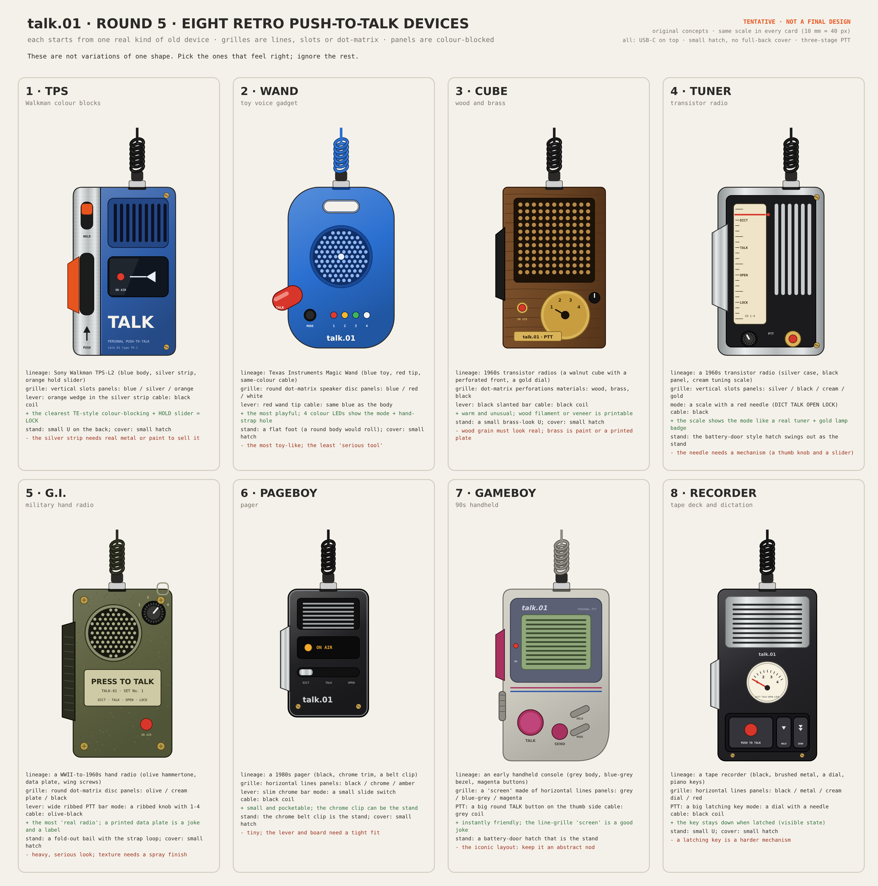

# Round 5 — eight retro push-to-talk devices

Date: 2026-11-25 · Status: **sketches for the owner's taste. Dimensions are guesses; nothing built or measured.**



Files: [`round5.svg`](round5.svg) · [`round5.png`](round5.png)

## What the owner said, and what changed

On round 4 the owner said:

- It was **not more varied**: Cut was only the closest, not a base to refine. They wanted *more different* designs.
- It felt **too modern and technical**, not "retro tech". Starting from walkie-talkies, it should feel properly **old**.
- The **diagonal slots** were wrong. **Horizontal lines, vertical slots or dot-matrix perforations** suit the taste better.
- **TE colours whole panels differently** (colour-blocked panels).
- Claude should **look at real reference photos of old devices** itself, beyond the list the owner gave, and not decide from the written list.

So round 5 is **eight separate devices**, each starting from one real kind of old gear. They are not variations of one shape. No diagonal slots anywhere.

## The reference study (honest about its size)

I looked at real photos from Wikimedia Commons (viewed for study only; **no images are included in this repository**). Wikimedia then started throttling the connection, so I saw about **fifteen photos**, not the dozens I wanted. Devices like the Game Boy, Handie-Talkie, Speak & Spell and instant cameras are drawn from general knowledge, not from photos I looked at.

Photos viewed (titles as on Commons; look them up on [commons.wikimedia.org](https://commons.wikimedia.org)):

- *1970s Zodiac M 5026 27 MHz AM marine communication radio* (two views)
- *Vintage Dimestore Trick Transistor Radio With a Jump Out Rat, "Sany" Radio*
- *Vintage Sony Cube Radio, 6-Transistors, Model TR-1819*
- *Recreational Walkie Talkies*
- *Vintage Astatic Silver Eagle ... Desk Stand Microphone ... Grip-To-Talk & Push-To-Talk*
- *Motorola Pageboy II*
- *TuVM Stade, Philips N 1501* (a tape recorder)
- *Original Sony Walkman TPS-L2* and *Walkman TPS-L2*
- *Texas Instruments Magic Wand Speak & Learn*
- *Nokia 5110* and *iMac G3* (two photos)
- *J38 telegraph key*

What the photos showed (my reading):

- **Grilles** are fine **horizontal lines**, **tall vertical slots**, or a **field of round perforations** (dot-matrix). Diagonal slots do not appear.
- **Panels are colour-blocked**: blue body plus a silver metal strip plus tiny orange sliders (Walkman); black plus brushed metal (pager, tape recorder); walnut plus a gold dial (transistor cube).
- **Printing and lettering**: raised capital words, small capital labels next to knobs (VOLUME, SQUELCH, CHANNEL), arrow pictograms, data plates.
- **Chunky molded shapes** with generous radii, big knobs with ribs, brass or chrome screws, a nameplate.
- **A coiled cable can match the body colour** (the TI toy's blue coil), not only the accent colour.

## The eight

| # | Name | From | Grille | Palette |
|---|---|---|---|---|
| 1 | **TPS** | Walkman | vertical slots | blue, silver strip, orange hold slider |
| 2 | **Wand** | the TI toy voice gadget | dot-matrix disc | blue, red tip, same-colour cable |
| 3 | **Cube** | 1960s transistor radio | dot-matrix field | walnut, brass dial |
| 4 | **Tuner** | transistor radio | vertical slots | silver, black, cream scale, gold lamp |
| 5 | **G.I.** | military hand radio | dot-matrix disc | olive hammertone, cream data plate |
| 6 | **Pageboy** | pager | horizontal lines | black, chrome, amber |
| 7 | **Gameboy** | early handheld | horizontal lines as a "screen" | grey, blue-grey, magenta |
| 8 | **Recorder** | tape deck | horizontal lines | black, metal, cream dial, red |

Shared baseline (identical in all): **USB-C on top with a coiled cable**, a **small hatch** (no full-back cover) and a **small U stand or hatch-as-stand**, a **three-stage push-to-talk control**. How the control looks differs: a slanted wedge or bar on the edge, a big round button (Wand's red tip, Gameboy's TALK button) or a latching key (Recorder).

## Notes

- Each card lists its lineage, grille, palette, lever, cable, stand and a plus and a minus. The pluses and minuses are my opinion.
- **Gameboy** and the iMac-style translucent idea borrow *vocabulary* only (grey and magenta, a "screen" made of lines); the layout is an abstract nod, not a copy of an iconic design.
- Colours are guesses. The owner said colour is not the problem; the point of this sheet is the **shape and character**.

## Questions for the owner

1. Which ones feel right? One word each is plenty. Which feel wrong?
2. Is this the "retro tech" you meant? What is still too modern?
3. Is a **toy** look (Wand) welcome, or too far from a serious device?
4. Which **grille** do you like most: vertical slots, horizontal lines or dot-matrix?
5. Should the cable match the body (Wand, G.I., TPS) or be a bright accent (earlier rounds)?

## Regenerating

[`../src/make_round5.py`](../src/make_round5.py) (it imports helpers from `make_concepts.py` and `make_round4.py`):

```bash
python3 design/concepts/src/make_round5.py design/concepts/round-5
```
