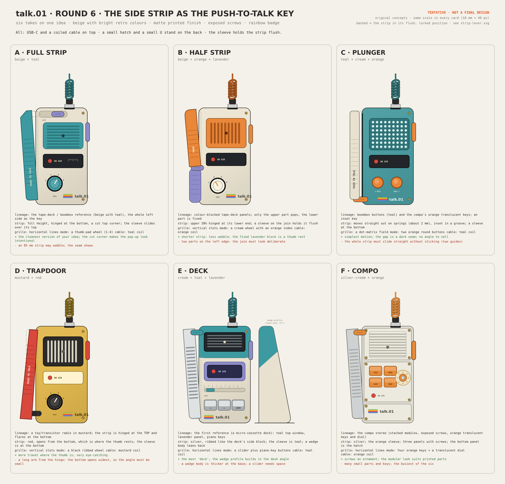
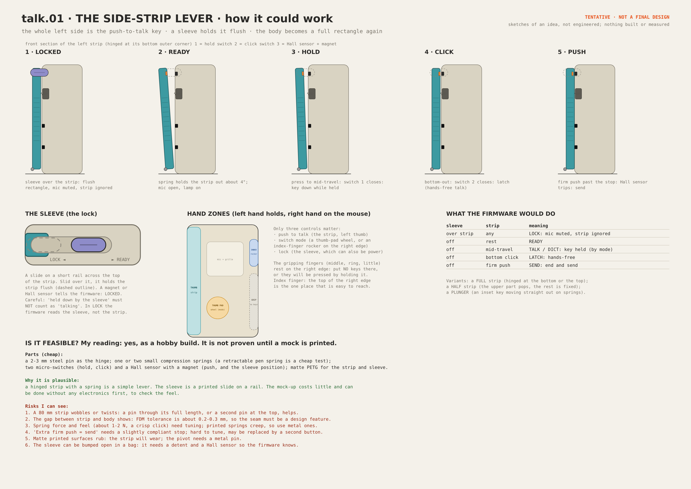

# Round 6 — the side strip as the push-to-talk key

Date: 2026-11-25 · Status: **sketches of an idea and six takes on it. Not engineered; nothing built or measured.**





Files: [`round6.svg`](round6.svg) · [`round6.png`](round6.png) · [`strip-lever.svg`](strip-lever.svg) · [`strip-lever.png`](strip-lever.png)

## What the owner said

- The **first design of round 5 (TPS)** was the favourite, especially its **separate long strip on the left**.
- The idea: make the **whole left side the push-to-talk key**. A spring pops it out (the top can have a cut corner or an inset design). Pressing it talks; pressing further sends. Then **a sliding sleeve (or similar) holds it down** so the body is a **full rectangle again**, which protects the key in a bag. It could also be only **part** of the side that pops up, with the rest fixed.
- **Ergonomics** with the left hand: the thumb presses; could the other fingers operate a key too, or a lever under the thumb pad? Think from the interactions: **hold to talk, switch mode, maybe switch mode again or power**; there are only a few.
- **Back**: a **small U stand** and a **small openable hatch**, with pins inside so users can write their own programs.
- The owner sent **four reference photos** (a micro-cassette deck render in cream with teal and lavender; a stacked compo stereo with visible screws and orange translucent keys; a linear-tracking turntable with a translucent blue record; a cream and teal boombox). They are not stored in this repository.
- **Matte** materials: the round parts will be 3D printed in a matte finish.
- **Palette**: retro **beige with bright colours** such as teal, in a multicolour spirit like the old Mac, Windows and Chrome logos.
- Wanted: **more designs** in this direction, and a view on whether the side-strip idea **can be built**.

## Is the side strip feasible?

**My reading: yes, as a hobby build. It is not proven until a mock is printed.** Details are in [`strip-lever.png`](strip-lever.png).

- It is a **hinged strip with a spring**: a simple lever. A steel pin as the hinge, one or two small compression springs (a retractable pen spring is a cheap test), two micro-switches and a Hall sensor with a magnet.
- Stages: **locked** (sleeve over the strip, flush, mic muted, strip ignored) → **ready** (spring holds it out about 4°) → **hold** (mid-travel, key down while held) → **click** (bottom-out, latch) → **push** (extra firm push, send).
- **A key subtlety:** a strip held down *by the sleeve* must not count as "talking". The firmware should read the sleeve position (a magnet or Hall sensor), and ignore the strip while it is locked.
- Risks I can see: an 80 mm strip may wobble or twist; the gap shows (FDM tolerance about 0.2-0.3 mm); spring feel needs tuning and printed springs creep; the "extra push = send" stage needs a compliant stop and may become a second button; matte printed parts rub; the sleeve could be bumped open in a bag, so it needs a detent and a sensor.
- Cheap first step: print a **mechanical-only mock** and check the feel before any electronics.

## Hand zones

(Only my reading of a left-hand grip; to be checked in a real hand.)

- **Thumb:** the strip (push to talk). A **thumb-pad wheel** just below could switch mode.
- **Index finger:** the top of the right edge is the one easy place: a small **rocker** for mode.
- **Middle, ring, little fingers:** they grip the right edge. **Put no keys there**, or they will be pressed by holding the device.
- The sleeve can double as **power / lock**.

## The six

| | Idea | Strip | Grille | Palette |
|---|---|---|---|---|
| **A · Full strip** | the cleanest version of the idea | full height, hinged at the bottom, a cut top corner | horizontal lines | beige + teal |
| **B · Half strip** | only the upper part pops; a fixed lavender block is the thumb rest | upper 58% | vertical slots | beige + orange + lavender |
| **C · Plunger** | an inset key moving straight out on springs | parallel motion, about 2 mm | dot-matrix | teal + cream + orange |
| **D · Trapdoor** | hinged at the top, flaring at the bottom where the thumb rests | red strip | vertical slots | mustard + red |
| **E · Deck** | the cassette-deck reference: teal window, lavender panel, piano keys, a wedge profile | silver ribbed strip | horizontal lines | cream + teal + lavender |
| **F · Compo** | the compo reference: stacked panels, visible screws, orange translucent keys | silver strip | horizontal lines | silver-cream + orange |

Shared: **USB-C with a coiled cable on top**, a **small hatch and a small U stand** on the back (not drawn in this round), a **sleeve** that holds the strip flush, an exposed-screw detail and a **rainbow-stripe badge**. In the drawings the strip is shown popped out, with a **dashed outline** for its flush, locked position.

## Not done yet

- The **back** (U stand, hatch with the programming pins) is not drawn yet; it is in the plan.
- **Matte** is described, not shown: the drawings are flat colour with a soft gradient.
- Colours are guesses from the owner's references.

## Questions for the owner

1. Which of A-F? And which **strip type**: full, half, plunger or trapdoor?
2. **Mode control**: a thumb-pad wheel, an index-finger rocker on the right edge, piano-style keys, or a slider?
3. Should the **sleeve** also be the **power switch** (locked = off)?
4. Does the **beige + teal/lavender/orange** direction feel right? Which one is closest?
5. Should the next round draw the **back** (U stand and hatch with pins) for the favourites?

## Regenerating

[`../src/make_round6.py`](../src/make_round6.py) (it imports helpers from earlier scripts):

```bash
python3 design/concepts/src/make_round6.py design/concepts/round-6
```
