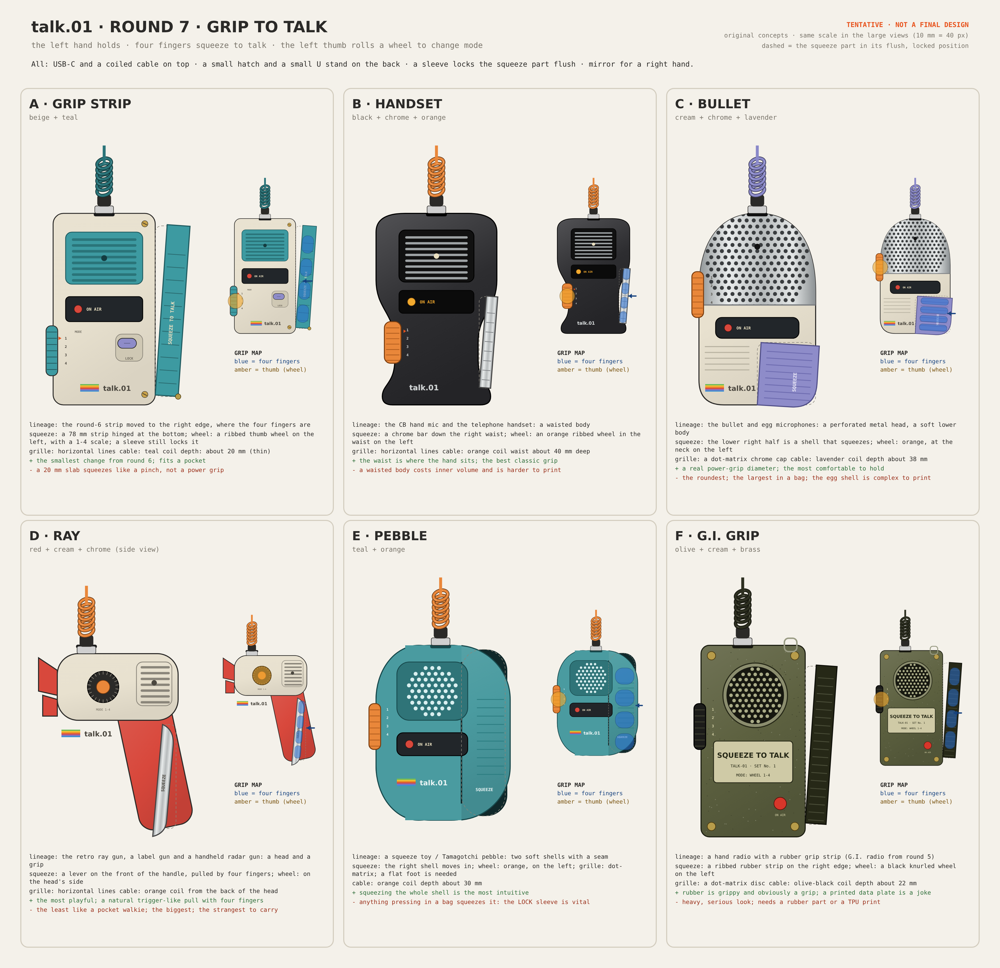
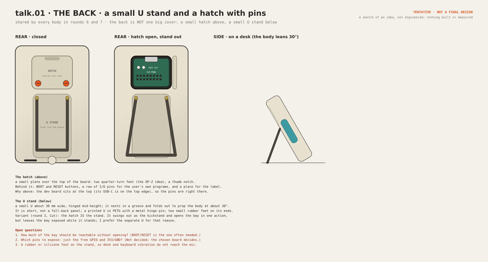

# Round 7 — grip to talk

Date: 2026-11-25 · Status: **sketches of an idea in six forms. Not engineered; nothing built or measured.**



Files: [`round7.svg`](round7.svg) · [`round7.png`](round7.png). Research and analysis: [`../../squeeze-grip.md`](../../squeeze-grip.md).

The **back** (small U stand and a hatch with pins) is drawn once for all the bodies: [`back.png`](back.png) / [`back.svg`](back.svg).



## The idea (owner)

Not locked into TE's key on the left: **the left hand holds the device, the four fingers squeeze to talk, and the left thumb rolls a wheel to change mode.** Claude was asked to design several forms and research it overnight.

## The six

Each card has the large drawing and a small **grip map**: **blue = the four fingers (squeeze)**, **amber = the thumb (wheel)**. The squeeze part is drawn popped out, with a dashed outline for its flush, locked position.

| | Form | Squeeze | Depth | Note |
|---|---|---|---|---|
| **A · Grip strip** | the round-6 slab, strip moved to the right | a 78 mm strip | about 20 mm | smallest change; thinnest; squeezes like a pinch |
| **B · Handset** | a waisted CB-mic / telephone-handset body | a chrome bar down the waist | about 40 mm at the waist | the classic hand-fitting shape |
| **C · Bullet** | a perforated chrome head over a soft body | the lower right half is a shell | about 38 mm | the most comfortable grip diameter; the roundest |
| **D · Ray** | a retro ray gun / label gun: head plus grip | a lever pulled by four fingers | grip about 26 mm | the most playful; the least like a pocket walkie |
| **E · Pebble** | two soft shells with a seam | the right shell | about 30 mm | the most intuitive; most easily squeezed in a bag |
| **F · G.I. grip** | an olive hand radio | a ribbed rubber strip | about 22 mm | grippy and obviously a grip |

Shared: **USB-C and a coiled cable on top**, a **ribbed thumb wheel on the left** with a 1-4 scale, a **LOCK sleeve** that holds the squeeze part flush, a **small hatch and U stand** on the back (see below), exposed screws, a rainbow badge. Mirror for a right hand.

## What the research says (short)

Full notes with sources: [`../../squeeze-grip.md`](../../squeeze-grip.md).

- A squeeze input exists (Google's Pixel 2 used strain gauges on the inner walls), and the **hard problem is telling a squeeze from simply holding**; even Google's nine-level sensitivity slider did not stop all accidental triggers.
- **Grip-to-talk has prior art** (the Astatic microphone's grip lever, non-locking by default, with a lock option).
- Comfortable power-grip diameters are around **30 to 50 mm**; our 20 mm slab is **thinner** than that, so a thin body squeezes like a pinch. **Pocketable versus squeezable is a real trade-off.** A (thin) and B, C, E (thicker) explore both ends.
- Risks: accidental talk, fatigue (so keep the latch), handling noise next to the mic, and no way to squeeze a standing device (so the wheel click can latch, or the stand pose can mean OPEN).

## Questions for the owner

1. Which of A to F? Is the **thickness** acceptable (a thicker body for a real grip), or must it stay pocket-thin?
2. **Wheel click = latch** (also the desk way to talk). Do you like that, or would you rather the click = send?
3. Should **a firmer squeeze** also be "send" (a second stage), or is one stage enough for a squeeze?
4. **D (Ray)** and **E (Pebble)** are far from a walkie. Interesting, or too far?
5. The **back** is now drawn ([`back.png`](back.png)): a small hatch above (with BOOT/RESET and I/O pins) and a small U stand below. Is that the right split, or should the hatch be the stand?

## Regenerating

[`../src/make_round7.py`](../src/make_round7.py) (it imports helpers from earlier scripts):

```bash
python3 design/concepts/src/make_round7.py design/concepts/round-7
```
