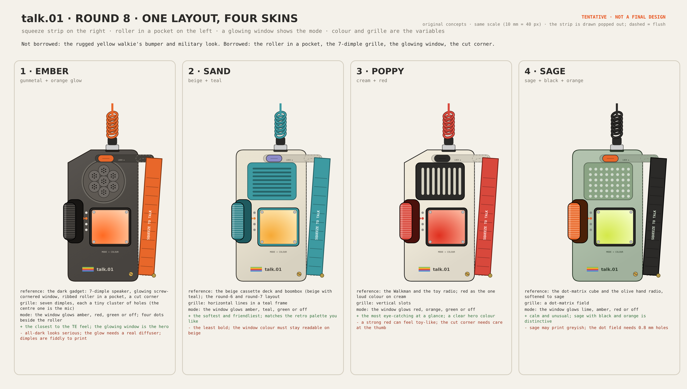
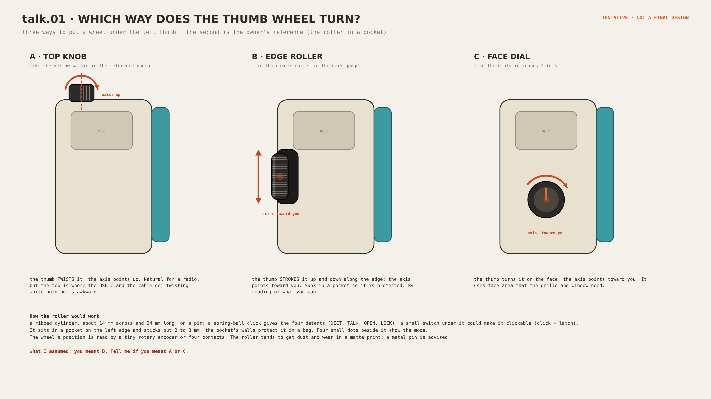

# Round 8 — one layout, four skins

Date: 2026-11-25 · Status: **sketches for the owner's taste. Not engineered; nothing built or measured.**





Files: [`round8.svg`](round8.svg) · [`round8.png`](round8.png) · [`wheel-study.svg`](wheel-study.svg) · [`wheel-study.png`](wheel-study.png).

## What the owner sent

Two more reference photos, not stored in this repository:

1. **A real yellow walkie-talkie** (rugged, a black rubber bumper, a knurled knob at the top left, a slide switch, a round grille with horizontal slots, a stubby antenna). The owner: the language is **too industrial and military**; they still prefer the **Teenage Engineering** feel. What matches the plan: **the thumb switches, the hand grips**. What differs: its knob is a **top knob that is twisted** (axis up); the owner imagines something else.
2. **A dark gadget** with a **glowing frosted square window with screws in the corners**, a **speaker made of seven small dimples** (each a tiny cluster of holes), small round buttons, a cut corner, and a **ribbed cylinder roller sunk into the bottom-right corner**. The roller is close to the owner's idea for switching modes. It sits in a corner, but **it need not be in a corner; on the edge is fine. The sunk-in feel is what to borrow.**

## How I read them

- **Not borrowed:** the first photo's rugged bumper and outdoor-military look.
- **Borrowed from the second:** the **roller in a pocket**, the **seven-dimple grille**, the **glowing window with screws**, the **cut corner**.
- **The wheel direction.** The owner said the first photo's wheel "turns the wrong way". My reading ([`wheel-study.png`](wheel-study.png)): the owner wants an **edge roller**, which the thumb **strokes up and down along the side**, with its axis pointing toward you. Not a top knob that is twisted (axis up), and not a dial on the face. I could be wrong; this is the first question below.
- The owner's line about "the right hand pressing the talk button": I read it as **the right-hand side of the device** (where the four fingers are). If the owner meant the other hand, tell me.

## The layout (the same in all four)

- **Four fingers** squeeze a **strip on the right edge** (a hinged, sprung strip; dashed = flush); a **sleeve** on a rail across the top locks it flush.
- A **ribbed roller in a pocket on the left edge**: the **left thumb** strokes it to change mode (four detents: DICT, TALK, OPEN, LOCK); **four dots** beside it show the mode.
- A **glowing frosted window with four screws** shows **the mode by colour**, instead of a screen or a row of lamps. (My idea, from the glowing window in the reference. It needs one RGB LED and a diffuser.)
- **USB-C and a coiled cable on top**, a **small hatch and a small U stand** on the back ([`../round-7/back.png`](../round-7/back.png)), a rainbow badge.

## The four skins

| | Colour | Grille | Corner |
|---|---|---|---|
| **1 · Ember** | gunmetal + orange glow | seven dimples | cut |
| **2 · Sand** | beige + teal | horizontal lines | round |
| **3 · Poppy** | cream + red | vertical slots | cut |
| **4 · Sage** | sage + black + orange | dot-matrix field | round |

Only the skin changes: colour, grille and corner. The **layout is fixed**, so this is a choice of look, not a new design each time. I chose this because after seven rounds the owner's preferences point at one layout; the skins show how far colour and grille change the character.

## Open points

- **Thickness** is still undecided (a thin 20 mm slab squeezes like a pinch; see [`../../squeeze-grip.md`](../../squeeze-grip.md)). These sketches show the front only.
- The **glowing window** needs a diffuser and one RGB LED; a **matte print** diffuses light, so a thin print may work, but this is untested.
- The **roller** gets dust and wear in a matte print; a metal pin is advised. A tiny encoder or four contacts read the position.
- The **seven-dimple** grille is fiddly to print; 0.4 mm holes will not print on a normal FDM printer, so the real holes would be larger or drilled.

## Questions for the owner

1. **The wheel:** is B (the edge roller, thumb strokes up and down) what you meant? Or A (top knob) or C (face dial)?
2. **The glowing window** showing the mode by colour: yes or no? (If no, the four dots beside the roller carry the mode.)
3. Which **skin**? Or a mix of two? Colour and grille are the easy part.
4. Round 7's forms (thin strip, handset, bullet, ray, pebble, G.I.): any reaction? This round used the thin one because it is the pocket-friendly one; tell me if you want a thicker body.

## Regenerating

[`../src/make_round8.py`](../src/make_round8.py) (it imports helpers from earlier scripts):

```bash
python3 design/concepts/src/make_round8.py design/concepts/round-8
```
