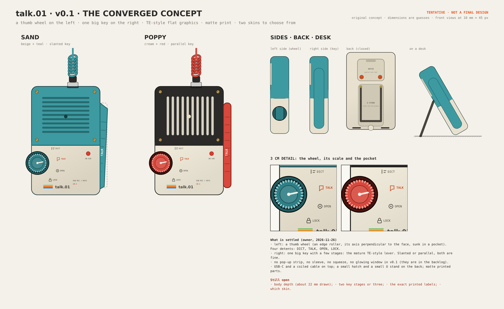
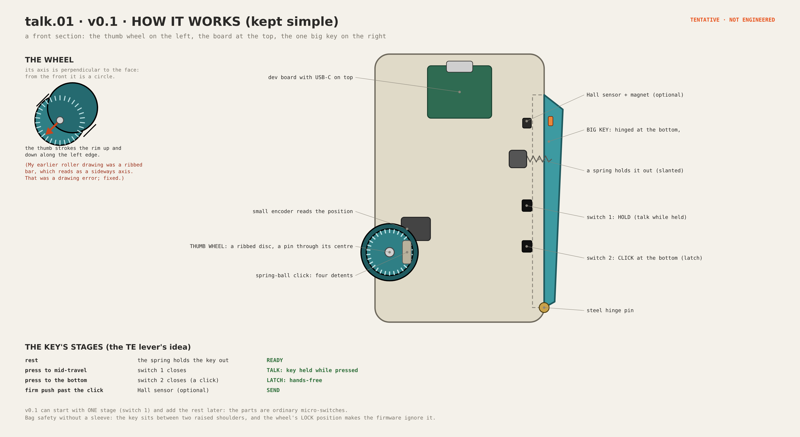

# v0.1 — the converged concept

Date: 2026-11-26 · Status: **a concept to choose a skin from. Dimensions are guesses; nothing built or measured.**





Files: [`concept.svg`](concept.svg) · [`concept.png`](concept.png) · [`how-it-works.svg`](how-it-works.svg) · [`how-it-works.png`](how-it-works.png). Decisions: [`../../../docs/decisions.md`](../../../docs/decisions.md).

## What changed

After many rounds the owner asked to **converge and simplify**:

- **Layout:** the TE microphone's: **a thumb wheel on the left, one big key on the right.**
- **The key:** the mature TE-style fixed big key with a few stages; **no** pop-up strip, sleeve or squeeze in v0.1.
- **The wheel:** an edge roller whose **axis is perpendicular to the face**. My earlier drawing was a ribbed bar that read as a sideways axis; **that was my drawing error.** From the front it should be a **circle** sunk in a pocket on the left edge, as it is now.
- **No glowing window.** (It was my own idea, taken from a reference photo: colour showing the mode. Dropped.)
- **Skins:** SAND (beige + teal, a slanted key) and POPPY (cream + red, a parallel key). Both were liked.
- **Design language:** TE-style flat graphics on the surface: a colour-blocked upper panel with the grille, a cream lower panel carrying the printed wheel scale with four small pictograms (DICT, TALK, OPEN, LOCK), a lamp, a wordmark and a few small labels, screws at the panel corners, and a coiled cable on top.

## How it works (simple)

Details in [`how-it-works.png`](how-it-works.png). In short:

- **The wheel:** a ribbed disc on a pin, with a spring-ball click for four detents and a small encoder to read the position.
- **The key:** hinged at its bottom on a steel pin; a spring holds it out; **switch 1** closes at mid-travel (hold to talk); **switch 2** closes at the bottom (latch); a Hall sensor and magnet are an optional extra for a "firm push".
- **v0.1 can start with one stage** (switch 1) and add the rest later; the parts are ordinary micro-switches.
- **Bag safety without a sleeve:** the key sits between two raised shoulders, and the wheel's LOCK position makes the firmware ignore the key.
- The back is the earlier design: a small hatch with the pins above, a small U stand below ([`../round-7/back.png`](../round-7/back.png)).

## Still open

1. **Which skin?** Or a mix (for example SAND's colours with POPPY's parallel key)?
2. **Slanted or parallel key?**
3. **How many stages** for the key in v0.1: one (hold), two (hold + latch), or three?
4. **Body depth** (about 22 mm drawn): is that acceptable?
5. **The printed labels** (DICT, TALK, OPEN, LOCK, ON AIR, "USB MIC + KEYS"): are the words and the little icons right?

## Suggested next steps (nothing started)

- A **printed mock-up** of the body, the wheel and the key with no electronics, to check the feel in a hand.
- Or, in parallel, the first **breadboard test**: the audio and keyboard on a development board (see [`../../../docs/research/claude-review.md`](../../../docs/research/claude-review.md)).
- Or more refinement of the graphics. Tell me which.

## Regenerating

[`../src/make_v01.py`](../src/make_v01.py) (it imports helpers from earlier scripts):

```bash
python3 design/concepts/src/make_v01.py design/concepts/v0.1
```
