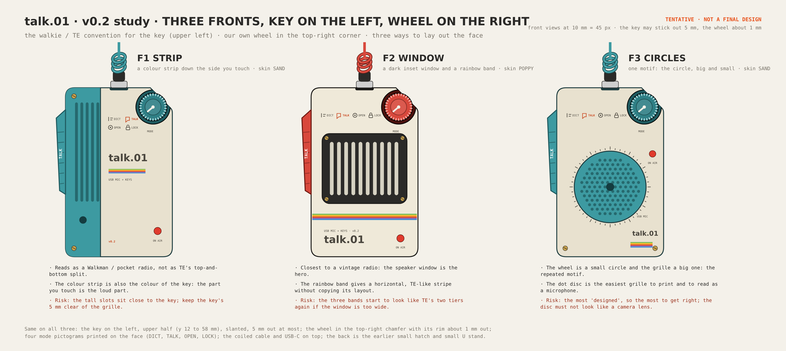
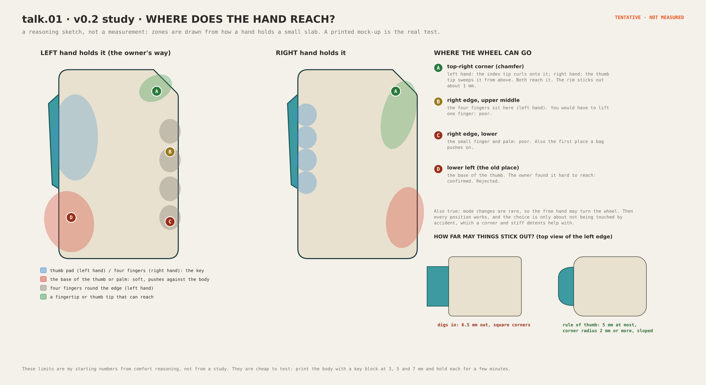

# v0.2 study: key on the left, wheel on the right

Date: 2026-11-26 · Status: **a study for the owner to react to. Nothing built or measured; the hand zones are drawn from reasoning, not from tests.**





Files: [`layouts.svg`](layouts.svg) · [`layouts.png`](layouts.png) · [`reach.svg`](reach.svg) · [`reach.png`](reach.png). Decisions: [`../../../docs/decisions.md`](../../../docs/decisions.md).

## What the owner asked (2026-11-26)

- The wheel at the lower left is hard to reach (it is where the base of the thumb sits). Move it.
- Most walkie-talkies, and TE, put the push-to-talk key on the **left**. Borrow that convention (not a copy): **key at the upper left**, **our own wheel on the right** (upper or lower right, whichever turns more easily; mode changes are rare).
- Edges that stick out must not dig into the hand.
- The front should have more of our own design than TE's top-grille / bottom-cream split.

## Is "PTT on the left" the consensus?

Honest answer: **I could not find a source that explains it.** What I found:

- Patents on radios ([US10251030](https://image-ppubs.uspto.gov/dirsearch-public/print/downloadPdf/10251030), [US11064316](https://patents.google.com/patent/US11064316)) say a radio with one PTT switch is ergonomically limited to a **right-handed** operator, and that a left-handed user finds it hard. So the left-side key is a **default that assumes a right hand**, and ambidextrous designs exist.
- A handset patent notes that a side PTT can be inconvenient when the device is worn on the body.
- **My own inference (unverified):** holding a radio in the right hand with the face toward you, the fingers wrap round the left edge, so a left-side key is under the fingers. For a **left** hand the left edge is where the **thumb** sits. So the left edge is reachable by the right hand's fingers and the left hand's thumb: a reasonable place either way. I have no manufacturer source for this.

Conclusion: it is a strong convention, not a law. Following it is fine and it suits the owner's left-hand grip.

## The wheel: recommended place A, the top-right corner

See the reach study ([`reach.png`](reach.png)):

- **A, a chamfered top-right corner** (recommended). With the left hand the index fingertip can curl onto it; with the right hand the thumb tip sweeps it from above; the free hand reaches it anyway. The rim sticks out only about **1 mm**, so it cannot dig in. Stiff detents plus the LOCK position guard against accidental turns.
- B (right edge, middle) and C (right edge, low): under the four fingers or the small finger and palm, and the first places a bag pushes. Poor.
- D (lower left, the old place): the base of the thumb. Confirmed bad. Rejected.

## Edges that stick out

My starting numbers (from comfort reasoning, not a study): the key **5 mm out at most**, corner radii **2 mm or more**, shoulders sloped; the wheel about **1 mm**. The cheap test is a printed body with key blocks at 3, 5 and 7 mm, held for a few minutes each.

## Three fronts (all with the key on the left, the wheel top-right)

| | Idea | Strength | Risk |
|---|---|---|---|
| **F1 STRIP** | a colour strip down the left side, cream on the right | Walkman-like, clearly not TE's split; the strip has the key's colour | the tall slots are close to the key |
| **F2 WINDOW** | a dark inset window as the grille, a rainbow band | closest to a vintage radio; easy to read | can drift back towards TE's two tiers |
| **F3 CIRCLES** | the circle as the motif: a dot-matrix disc, a tick ring, the wheel as its small twin | the most our own; the disc is easy to print | the most to get right; must not look like a camera lens |

Skins SAND and POPPY apply to any of them (F1 and F3 are drawn in SAND, F2 in POPPY).

## Questions for the owner

1. Do you hold it in the **left hand** all the time, or do you swap? (It changes which zones matter.)
2. Is the **top-right corner wheel** acceptable, or do you want to try B/C anyway?
3. Which front, F1, F2 or F3, or a mix?
4. Should the mode scale stay as four pictograms printed on the face?

## Regenerating

```bash
python3 design/concepts/src/make_v02.py design/concepts/v0.2
```
