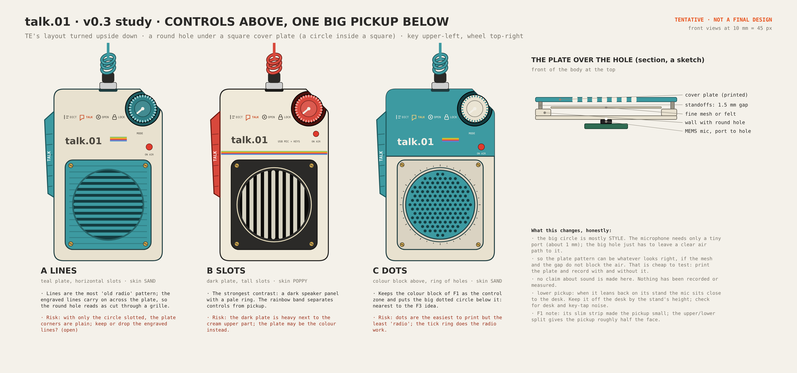

# v0.3 study: controls above, one big pickup below

Date: 2026-11-26 · Status: **a study to choose from. Nothing built, recorded or measured.**



Files: [`pickup.svg`](pickup.svg) · [`pickup.png`](pickup.png). Earlier step: [`../v0.2/README.md`](../v0.2/README.md). Decisions: [`../../../docs/decisions.md`](../../../docs/decisions.md).

## What the owner said (2026-11-26)

- The v0.2 layout (key upper-left, wheel on the right) is good. All three fronts F1, F2, F3 are liked.
- The sound hole goes in the **lower half**. A round hole is fine (F3). Vintage radios and speakers often put a **square cover plate over a round hole** (a circle inside a square), with the plate patterned as lines, slots or small holes.
- So: an **upper / lower structure**. Controls, indicator lamp and the rest **above**; **one big pickup area below**. It is TE's layout turned upside down (TE: grille on top, blank below).
- F1 is liked, but its pickup is too small and it loses the walkie-talkie feel.

## What is drawn

Three variants. All have the key upper-left, the wheel in the top-right chamfer, mode pictograms, lamp and wordmark above, and the plate (46 × 48 mm, round hole about 37 mm) below.

| | Plate and pattern | Strength | Risk |
|---|---|---|---|
| **A LINES** (SAND) | teal plate, horizontal slots through the hole, engraved lines continue to the plate edge | the most "old radio" pattern | plate corners are plain; are the engraved lines worth keeping? |
| **B SLOTS** (POPPY) | dark plate, pale ring, tall slots | strongest contrast; a rainbow band separates controls from pickup | the dark plate is heavy next to the cream upper part |
| **C DOTS** (SAND) | coloured upper block (F1's colour block, now the control zone), cream plate, ring of small holes with a tick ring | closest to F3; dots print easily | least "radio"; the tick ring does that work |

F1's colour block lives on as the upper control zone in C. The pickup is now roughly half the face, which answers the "too small" worry.

## The plate over the hole (sketch)

Front to back: a printed cover plate, a 1.5 mm gap on small standoffs, a fine mesh or felt, the wall with the round hole, then the small MEMS microphone on a PCB with its port facing the hole.

Honest points:

- The big circle is **mostly style**. A MEMS microphone needs only a ~1 mm port; the hole must just leave a clear air path to it. So the plate's pattern can be chosen for looks, **provided the mesh and gap do not block the air**.
- That is cheap to test: print the plate and record with and without it. **No claim about sound is made; nothing has been recorded or measured.**
- A **lower pickup** sits close to the desk when the body leans back on its stand. Check desk and key-tap noise, and keep the pickup off the desk by the stand's height.

## Questions for the owner

1. A, B or C, or a mix (for example C's colour block with B's slots)?
2. Engraved lines across the plate (A): keep or drop?
3. Plate colour: the loud colour (A, C) or dark (B)?
4. Is the plate printed in one piece with the front, or a separate plate with visible screws (as drawn)? A separate plate is easier to swap and to test acoustically.

## Regenerating

```bash
python3 design/concepts/src/make_v03.py design/concepts/v0.3
```
