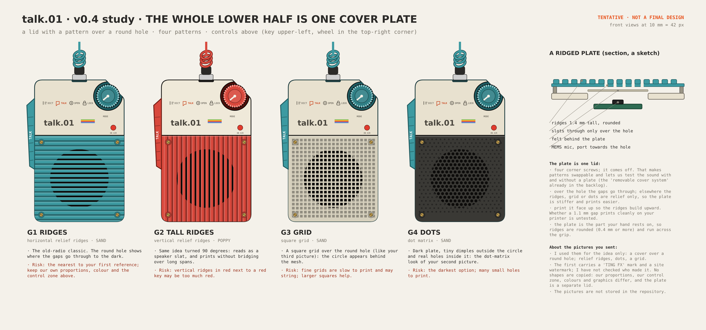

# v0.4 study: the whole lower half is one cover plate

Date: 2026-11-26 · Status: **a study to choose from. Nothing built, printed, recorded or measured.**



Files: [`plate.svg`](plate.svg) · [`plate.png`](plate.png). Earlier step: [`../v0.3/README.md`](../v0.3/README.md). Decisions: [`../../../docs/decisions.md`](../../../docs/decisions.md).

## What the owner said (2026-11-26)

- The v0.3 drawing differed a little from what was in mind, but was acceptable. The right feel is that of three reference pictures: a ridged cover over a round hole, a dot-matrix grille, and a square grid over round speaker cones.
- Instead of a small plate inset in the face, make **the whole lower half one cover plate**, like the first reference. Or other shapes: **show several designs**.

## What is drawn

One plate, 58 mm wide, from the seam at 36 mm down to the bottom edge, four corner screws. Over a round hole (about 38 mm): the pattern's gaps go **through** there; elsewhere the pattern is **relief only**. Controls stay above (key upper-left, wheel in the top-right corner, mode pictograms, lamp, wordmark).

| | Pattern | Strength | Risk |
|---|---|---|---|
| **G1 RIDGES** (SAND, teal) | horizontal relief ridges | the old-radio classic | nearest to the first reference: keep our own proportions, colour and control zone |
| **G2 TALL RIDGES** (POPPY, red) | vertical relief ridges | reads as a speaker slat; no long bridging when printed | a red plate next to a red key may be too much red |
| **G3 GRID** (SAND, grey) | square grid | like the third reference: the circle shows behind the mesh | fine grids are slow to print and may string |
| **G4 DOTS** (SAND, charcoal) | dimples outside, holes inside the circle | the dot-matrix look | the darkest; many small holes |

## Why one lid is a good idea

- It is **removable** (four screws): patterns and colours become swappable, which is the "removable cover system" already in [`../../../docs/feature-backlog.md`](../../../docs/feature-backlog.md).
- It lets us **test the sound with and without a plate**: print one, record both ways. No sound claim is made; nothing has been recorded.
- Relief outside the hole keeps the plate stiff and easier to print than a plate full of through-slots.
- It is the part the hand rests on: ridges rounded (0.4 mm or more) and running across the grip.
- FDM notes (untested): print face up so ridges build upward; whether a 1.1 mm gap or a fine grid prints cleanly on the owner's printer is unknown.

## About the reference pictures

Used for the **idea only** (a cover over a round hole; ridges, dots, grid). The first carries a "TING FX" mark and a site watermark; I have not checked who made it. No shapes are copied: proportions, control zone, colours and graphics differ, and ours is a separate lid. The pictures are **not stored** in the repository (licence not verified).

## Questions for the owner

1. Which of G1 to G4, or a mix (for example G1's horizontal ridges in G3's grey)?
2. Should the plate colour be the loud colour (G1, G2) or a quiet one (G3, G4)?
3. Is a removable plate wanted (four screws, swappable), or one printed piece?
4. Round hole about 38 mm: bigger and more 'speaker', or smaller?

## Regenerating

```bash
python3 design/concepts/src/make_v04.py design/concepts/v0.4
```
