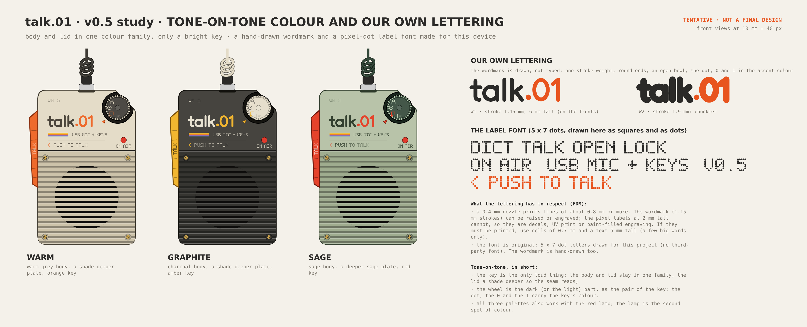
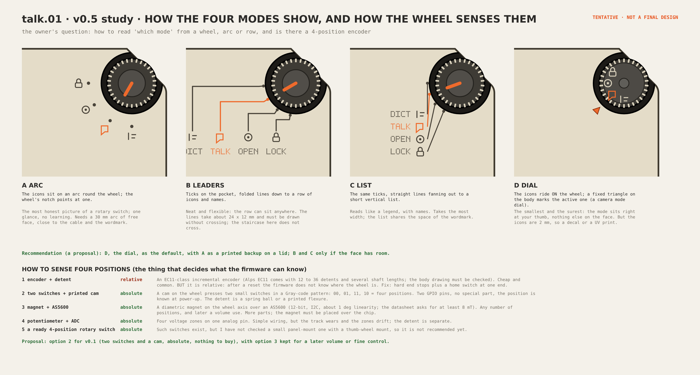
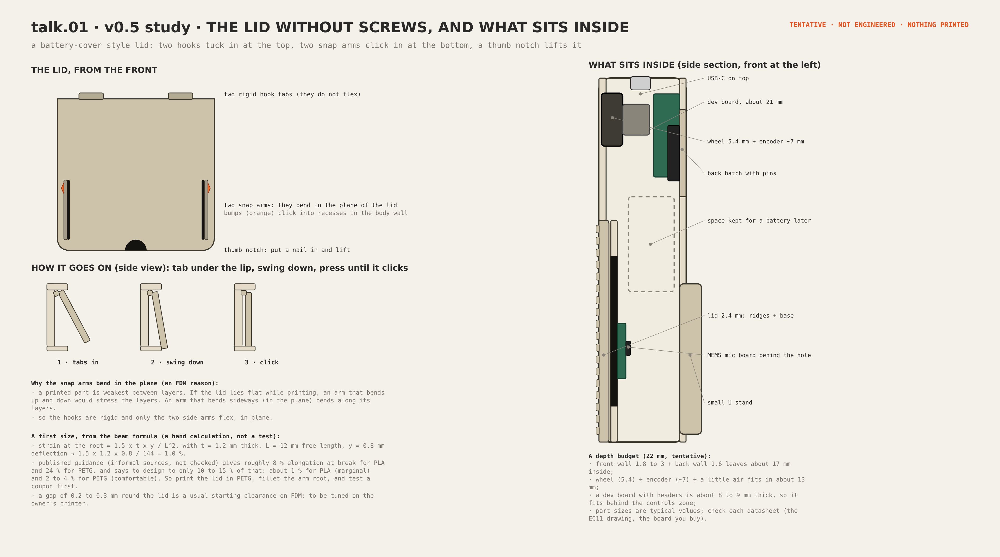

# v0.5 study: tone-on-tone colour, our own lettering, the mode wheel, a snap-fit lid

Date: 2026-11-26 · Status: **a study for the owner to react to. Nothing built, printed, recorded or measured. Part sizes are typical values to be checked against datasheets.**







Files: [`palette.svg`](palette.svg) · [`mode.svg`](mode.svg) · [`lid.svg`](lid.svg) (each with a `.png`). Earlier step: [`../v0.4/README.md`](../v0.4/README.md). Decisions: [`../../../docs/decisions.md`](../../../docs/decisions.md).

## What the owner asked (2026-11-26)

The prototype looks good and the plate is replaceable anyway. Polish the details, and design with real mechanics and electronics in mind:

1. **Colour:** a dark/light scheme by default; **not** the same colour as the key (G1, G2). The key is bright; the body is one colour or a small tonal difference.
2. **Panel:** better and more personal; the lettering on the reference pictures was carefully designed.
3. **Lid:** no screws; a snap fit, like a battery cover that the user can remove and swap.
4. **Modes:** how to build the rotary part (is there a 4-position encoder?), and how the position should be shown: along an arc, in a row with folded guide lines, or otherwise. Top rotary knobs on other walkies might be a volume control; optional, later.

## 1 · Colour: tone-on-tone ([`palette.png`](palette.png))

Three palettes, all with a bright key and body and lid in one family (the lid a shade deeper so the seam reads): **WARM** (warm grey, orange key), **GRAPHITE** (charcoal, amber key), **SAGE** (sage green, red key). The wheel is the dark (or light) pair of the key; the dot, the 0 and the 1 of the wordmark carry the key colour. The red lamp is the second spot of colour.

## 2 · Our own lettering ([`palette.png`](palette.png))

- A **hand-drawn wordmark** "talk.01": one stroke weight, round ends, an open bowl, the dot, 0 and 1 in the accent colour. Two weights (W1 1.15 mm, W2 1.9 mm at 6 mm tall).
- A **pixel-dot label font** (5 × 7) drawn for this project, used for the small labels. Both are original (no third-party font, so no licence question).
- **FDM reality:** a 0.4 mm nozzle prints lines of about 0.8 mm or more. The wordmark can be raised or engraved. The 2 mm pixel labels cannot be printed: they are decals, UV print or paint-filled engraving; if printed, use 0.7 mm cells (text about 5 mm tall, a few big words).
- Also new on the face: "PUSH TO TALK <" next to the key, a rule, and the version in pixel dots.

## 3 · The modes ([`mode.png`](mode.png))

Four ways to show where the wheel is:

| | Idea | Note |
|---|---|---|
| A ARC | icons on an arc round the wheel; a notch on the wheel points at one | the clearest picture of a rotary switch; needs about 30 mm of free face |
| B LEADERS | ticks on the pocket, folded lines down to a row of icons and names | the row can sit anywhere; the lines take about 24 × 12 mm and must not cross (the staircase drawn does not) |
| C LIST | ticks and straight lines fanning to a short list | reads as a legend; takes the most width |
| **D DIAL** | the icons ride **on** the wheel; a fixed triangle on the body marks the active one (a camera mode dial) | **proposal.** The smallest, the surest, nothing else on the face; icons are 2 mm, so decal or UV print |

### Is there a 4-position encoder, and how to sense it?

The deciding question is **absolute or relative**. A usual **incremental encoder** (the Alps EC11 family comes with several detent counts and shaft lengths; see [the Alps datasheet](https://www.avnet.com/opasdata/d120001/medias/docus/196/Alps-Alpine-EC11-Series-EN-Datasheet.pdf), I could not read the body height from it and it must be checked) is **relative**: after a reset the firmware does not know where the wheel stands, so the printed position and the mode can disagree. Options, in my order of preference for v0.1:

1. **Two small switches and a printed cam** (Gray code 00, 01, 11, 10 = four positions): absolute, two pins, nothing special to buy; the detent is a spring ball or a printed flexure. **Proposal for v0.1.**
2. **Magnet plus an AS5600** magnetic angle sensor: absolute, 12-bit, I2C, about 1° linearity, a minimum field of about 8 mT per the [ams OSRAM/Infineon datasheet](https://www.infineon.com/assets/row/public/documents/24/49/infineon-as5600-datasheet-en.pdf) (via a [product summary](https://www.mouser.in/new/ams/ams-as5600-sensor/)). More parts; keep for a later volume or fine control.
3. An **EC11 encoder with end stops and a home switch**: cheap and common, but needs the extra home handling.
4. A potentiometer and an ADC: simple but wears and drifts.
5. A ready 4-position rotary switch: they exist, but I have not checked a small panel-mount one with a thumb wheel, so not recommended yet.

### Top rotary knob / volume

Many walkies carry a top knob for volume or channel. For a USB microphone the useful knob is **gain**, not speaker volume. It could be the same wheel in another mode, or a second small knob on the top edge. **Later**; the AS5600 option would make it easy. Not in v0.1.

## 4 · The lid without screws ([`lid.png`](lid.png))

A battery-cover style lid: **two rigid hook tabs** tuck under a lip at the top, then the lid swings down and **two snap arms** click into recesses in the body wall; a **thumb notch** at the bottom lifts it.

- The arms bend **in the plane of the lid**: a printed part is weakest between layers, so an arm that flexes sideways bends along its layers while the lid lies flat. The hooks are rigid.
- **First size from the beam formula (a hand calculation, not a test):** strain at the root = 1.5 · t · y / L²; with t = 1.2 mm, L = 12 mm, y = 0.8 mm → **about 1.0 %**. Informal guides cited roughly 8 % elongation at break for PLA and 24 % for PETG and advise designing to only 10 to 15 % of it ([guidance 1](https://www.sovol3d.com/blogs/news/3d-printed-snap-fit-joints-how-to-design-clips-that-work), [guidance 2](https://hackaday.com/2022/11/11/oh-snap-3d-printing-snapping-parts-without-breakage), [formula](https://www.fictiv.com/articles/how-to-design-snap-fit-components)); that makes 1 % marginal for PLA and comfortable for PETG. **Print the lid in PETG, fillet the arm root and test a coupon first.** The sources disagree on the numbers.
- A gap of 0.2 to 0.3 mm round the lid is a usual starting clearance; tune on the owner's printer.

### What sits inside ([`lid.png`](lid.png), right)

A side section: lid (2.4 mm), felt, front wall with the round hole, the MEMS mic board behind it, a development board behind the controls zone with USB-C on top, the wheel (about 5.4 mm) and an encoder (about 7 mm) behind it, space kept for a battery later, the back hatch with pins and the small U stand. About 17 mm of the 22 mm depth is inside; the stack fits on paper. Every size is a typical value to confirm.

## Questions for the owner

1. Which palette: WARM, GRAPHITE or SAGE (or a mix)?
2. Mode display: D (dial) as proposed, or A/B/C? Would icon-only on the wheel be clear enough, or do you want names printed too?
3. Are you happy with **two switches and a cam** for the first wheel (absolute, nothing to buy), keeping the magnet sensor for later?
4. Lid: hooks at the top and two snap arms at the bottom, as drawn? PETG available?
5. Wordmark: W1 or the chunkier W2? Pixel labels as decals or UV print, or only a few large printed words?

## Regenerating

```bash
python3 design/concepts/src/make_v05.py design/concepts/v0.5
```
