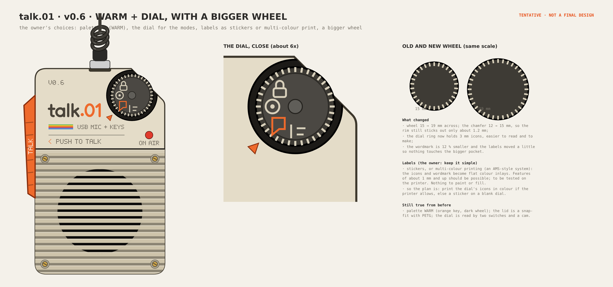
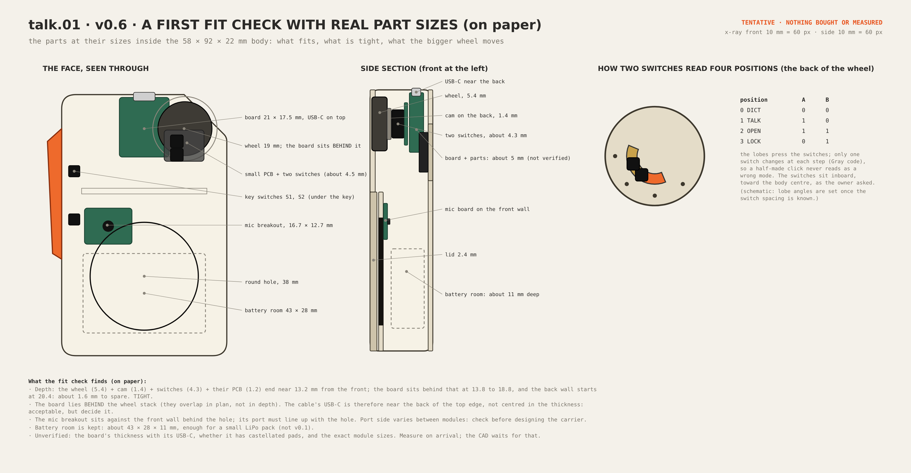

# v0.6: WARM + dial with a bigger wheel, and a first fit check

Date: 2026-11-26 · Status: **paper only. Nothing bought, measured or printed. Sizes are typical or from listings; see [`../../../docs/research/component-selection.md`](../../../docs/research/component-selection.md).**





Files: [`front.svg`](front.svg) · [`fit.svg`](fit.svg) (with `.png`). Earlier: [`../v0.5/README.md`](../v0.5/README.md).

## What the owner decided (2026-11-26)

- Palette **1 (WARM)**; the **dial** for the modes (the most stable).
- Keep it simple: **stickers, or multi-colour (AMS-style) printing**, nothing to paint or fill.
- A **bigger wheel**, since the icons must be printed on it, and it gives character.
- Sensing option 2 (two switches and a cam), with the sensors placed a little further **inboard** to leave room.
- The look (circles, ridges, tactile details) is good. Next: fix the part choices, then design a buildable version from the real part sizes.

## What changed

- Wheel **15 → 19 mm**; chamfer 12 → 15 mm so the rim still sticks out only about 1.2 mm. The dial ring holds 3 mm icons.
- Wordmark 12 % smaller; labels shifted so nothing touches the bigger pocket.
- Labels as flat colour inlays (multi-colour print) or stickers on a blank dial: to be tested on the printer.

## The fit check (on paper)

- Depth is **tight**: wheel 5.4 + cam 1.4 + switches 4.3 + their board 1.2 end near 13.2 mm; the controller board sits behind that (13.8 to 18.8); the back wall starts at 20.4: about **1.6 mm spare**.
- The board lies **behind** the wheel stack, so the cable's USB-C is near the back of the top edge.
- The mic breakout sits on the front wall behind the hole; its **port side** must be checked.
- Room for a small battery (about 43 × 28 × 11 mm) is kept for later.
- Two switches read four wheel positions in Gray code (drawing is schematic).

## Questions for the owner

1. Is the part list in [`component-selection.md`](../../../docs/research/component-selection.md) right: XIAO ESP32S3 + two I2S mic modules to compare + small switches + a coiled USB-C cable?
2. May the body grow from 22 to 24 mm if the real parts need it?
3. Should I treat "measure the real parts first, then CAD" as the next step?

## Regenerating

```bash
python3 design/concepts/src/make_v06.py design/concepts/v0.6
```
